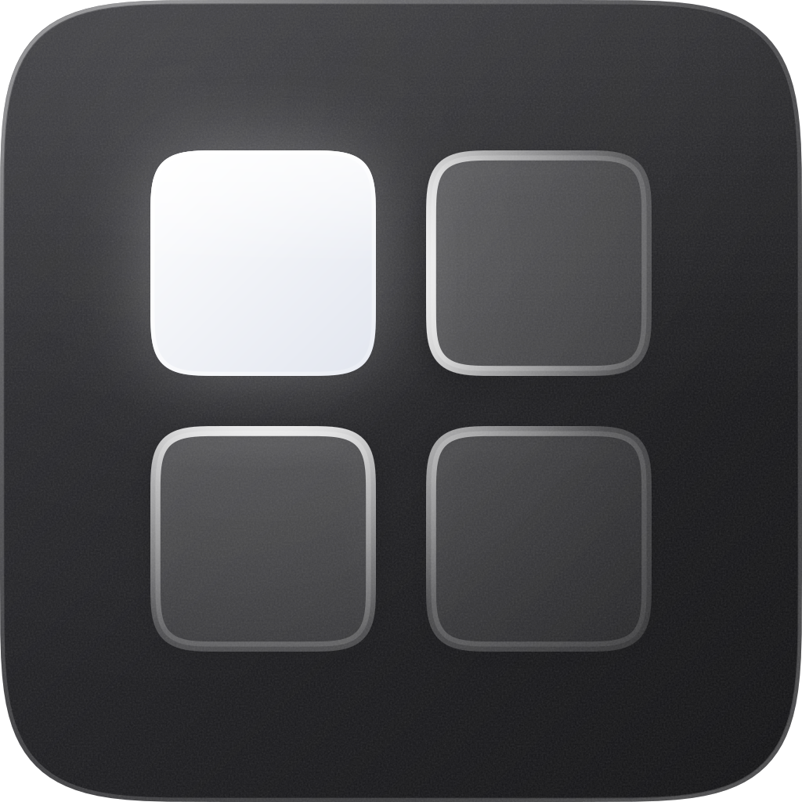
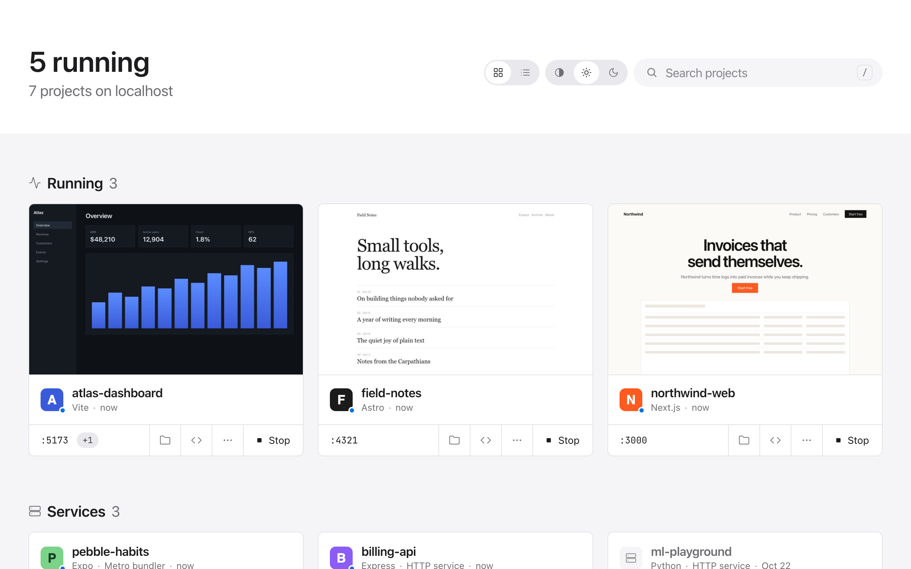
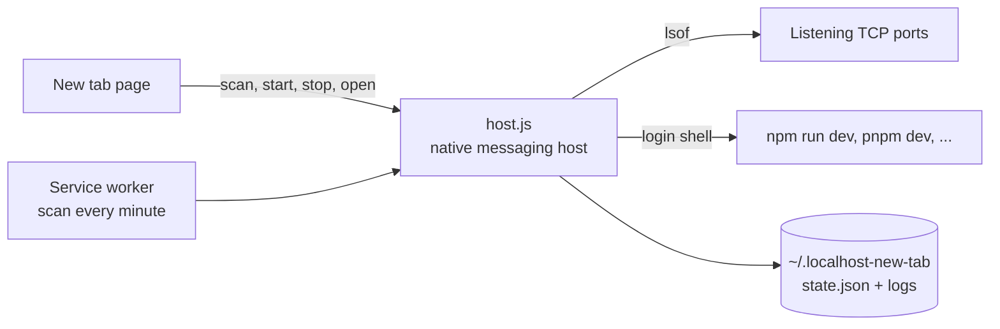

<p align="center">
  
</p>

<h1 align="center">Localhost New Tab</h1>

<p align="center">
  Every project you've run on localhost, one new tab away.<br>
  <a href="https://chromewebstore.google.com/detail/iafmjppjfdddcnlanldpmjejhpbikdem"><strong>Chrome Web Store</strong></a> · <a href="https://arcadie2k.github.io/localhost-new-tab/demo/">Live demo</a> · <a href="#install">Install</a> · <a href="#how-it-works">How it works</a>
</p>

<picture>
  <source media="(prefers-color-scheme: dark)" srcset="docs/hero-dark.png">
  
</picture>

## Why

If you build with AI, you probably start projects faster than you finish them. A prompt turns into a Vite app, an idea at midnight turns into a Next.js prototype, and a week later you have a dozen folders, a few dev servers still running, and no idea which one is on `:3000`.

Meanwhile, the new tab is the page I open most and use least. A search box I never type into, shortcuts I never click.

So I made it useful: every project I've started on localhost, running or not, with a live preview and one click to start it, stop it or open it in my editor. If you vibe code as much as I do, it's probably the tab you're missing too.

## What it does

- **Remembers every local project** you've run, keyed by folder, with its framework, ports and last-seen time
- **Live previews** of each running app, so you recognise projects at a glance
- **Start and stop** dev servers from the tab, using the project's own `dev` script and package manager
- **Jump to the code**: open the folder in Finder, your editor (VS Code, Cursor, Zed, WebStorm and more) or a terminal
- **Services** like APIs and Metro bundlers are detected and shown compactly, separate from web apps
- **Port conflicts** are handled: if two projects use `:3000`, both stay listed and you get a "stop the other and start" choice
- **Grid or list**: big previews, or a compact row per project when you have a lot of them
- **Pin** the projects you care about, **search** with `/`
- **Theme**: auto, light or dark, and reduced motion is respected

## Install

You need **macOS**, **Node.js 18 or newer** and a Chromium browser: **Chrome**, Brave, Arc or Chromium.

### From the Chrome Web Store

1. Add [Localhost New Tab](https://chromewebstore.google.com/detail/iafmjppjfdddcnlanldpmjejhpbikdem) to Chrome.
2. Open a new tab. It shows a one-line command with your extension ID already filled in. Click **Copy command** and paste it in Terminal.
3. Reload the tab. Any dev server you have running shows up right away.

The command downloads the helper for this exact version, installs it to `~/.localhost-new-tab/bin`, registers it with every supported browser it finds and cleans up after itself. [Read the script](install.sh) first if you like; it's short.

### From source

```bash
git clone https://github.com/arcadie2k/localhost-new-tab.git
cd localhost-new-tab
```

Open `chrome://extensions`, turn on **Developer mode**, click **Load unpacked** and select the `extension/` folder. Then install the helper from the clone, using the ID shown on `chrome://extensions`:

```bash
./install.sh <your-extension-id>
```

### Updating

The store version of the extension updates itself; the helper doesn't. When a release changes the helper, its release notes say so, and running the install command again updates it. From source: `git pull`, click the reload icon on the extension in `chrome://extensions`, and run `./install.sh <your-extension-id>` again so the helper is updated too.

### Troubleshooting

- **The setup screen doesn't go away:** make sure the ID you passed to `install.sh` matches the one on `chrome://extensions`, then reload the tab.
- **It stopped working after switching Node versions** (nvm, fnm, volta): the helper remembers the Node it was installed with. Run `./install.sh <your-extension-id>` again.
- **Something else:** errors from the helper go to `~/.localhost-new-tab/host.err`.

### Uninstall

Remove the extension from `chrome://extensions`. Chrome then opens a page with the command below, because removing an extension can't clean up files on your Mac by itself.

```bash
curl -fsSL https://raw.githubusercontent.com/arcadie2k/localhost-new-tab/main/install.sh | sh -s -- --uninstall
```

From a clone, `./install.sh --uninstall` does the same. It deletes the helper, its registration in each browser and the whole `~/.localhost-new-tab` folder. Add `--keep-history` to keep your project list for a later reinstall.

**What's on disk while installed:** the helper in `~/.localhost-new-tab/bin`, your project history (`state.json`, a few KB), start logs in `logs/`, and one small registration file per browser in its `NativeMessagingHosts` folder. Previews are taken with a throwaway browser profile that's deleted right after each capture.

## How it works

A web page can't see local processes, so the extension talks to a tiny helper through Chrome's [native messaging](https://developer.chrome.com/docs/extensions/develop/concepts/native-messaging). There is no daemon: Chrome launches the helper for each request and it exits right after.



- **Scan:** `lsof` lists listening ports, each process is mapped to its project root (nearest `package.json`, `.git`, `pyproject.toml`, ...) under your home folder, and each port is probed to tell web apps from APIs and raw TCP.
- **Start:** runs the saved command (default: the `dev`/`start` script via the lockfile's package manager) in your login shell, detached, logging to `~/.localhost-new-tab/logs/`.
- **Stop:** SIGTERM to the listening process and its runner parents (`npm`, `pnpm`, `node`, ...), never past your shell; SIGKILL after 4 seconds.
- **Previews:** captured with headless Chrome against `localhost` only.

`install.sh` copies the helper to `~/.localhost-new-tab/bin` because macOS privacy rules stop Chrome from launching scripts inside `~/Desktop` or `~/Documents`. If you edit `host/host.js`, run it again.

Debug the helper directly:

```bash
node host/host.js --cli '{"type":"scan"}'
```

## Privacy

Nothing leaves your computer. No server, no analytics, no account. The extension can only reach `http://localhost` and `http://127.0.0.1`. Project history is a JSON file in your home folder; previews live in Chrome's local extension storage. When you remove the extension, Chrome opens a [page](uninstall/index.html) with the one command that deletes everything else. Full policy: [store/privacy-policy.html](store/privacy-policy.html).

## Borrow from it

Fork it, or just lift the parts you like. Some pieces that might be useful elsewhere:

| Idea | Where |
| --- | --- |
| Native messaging host with a CLI mode for debugging | [host/host.js](host/host.js) |
| Getting around macOS TCC when a native host lives in `~/Desktop` | [install.sh](install.sh) |
| Classifying ports as web app, HTTP service or raw TCP with a 1.2s probe | `probe` in [host/host.js](host/host.js) |
| Cards that travel between sections with the View Transitions API | `render` in [extension/newtab.js](extension/newtab.js) |
| A warm editorial theme as plain CSS tokens, light and dark | top of [extension/newtab.css](extension/newtab.css) |
| An app icon drawn entirely in code (SVG, squircle math, glass tiles) | [scripts/icons.js](scripts/icons.js) |
| Store screenshots, promo tiles and social images rendered from fictional data | [scripts/store-assets.js](scripts/store-assets.js) |
| A fake `chrome.*` API so the real UI runs as a static demo | [scripts/demo/mock.js](scripts/demo/mock.js) |

## Project layout

```
extension/        the Chrome extension (Manifest V3, no build step)
host/host.js      native messaging helper (Node, no dependencies)
install.sh        registers the helper for Chrome, Brave, Arc, Chromium
scripts/          icon, store asset, demo and packaging scripts
demo/             generated static demo (served by GitHub Pages)
docs/             README images
assets/           icon sources and social images
store/            Chrome Web Store listing copy, privacy policy, screenshots
```

## Scripts

| Command | What it does |
| --- | --- |
| `node scripts/icons.js` | Regenerates every icon size from code |
| `node scripts/store-assets.js` | Regenerates store screenshots, promo tiles, README images, social images and `demo/` |
| `./scripts/package.sh` | Builds `dist/localhost-new-tab-<version>.zip` for the Chrome Web Store |
| `python3 -m http.server 4173 -d demo` | Serves the demo at `localhost:4173`. Add `?theme=dark` to force dark mode, or `?shot` to hide the demo banner for screenshots |

## Roadmap

Ideas for where the new tab goes next. Open an issue if you want one of them sooner, or have your own.

- [ ] **Clocks**: a digital or classic analog clock in the header, plus extra time zones
- [ ] **Bookmarks in folders**: your most used links grouped next to your projects
- [ ] **Helper version check**, so the new tab tells you when to update the helper
- [ ] **Windows and Linux** support for the helper
- [ ] **Project notes and tags**, to remember what a half-finished prototype was for
- [ ] **Git status at a glance**: branch and uncommitted changes on each card

## Limitations

- macOS only for now. The helper relies on `lsof`, `ps` and macOS app paths.
- Projects outside your home folder aren't tracked.

Issues and pull requests are welcome.

## License

[MIT](LICENSE)
